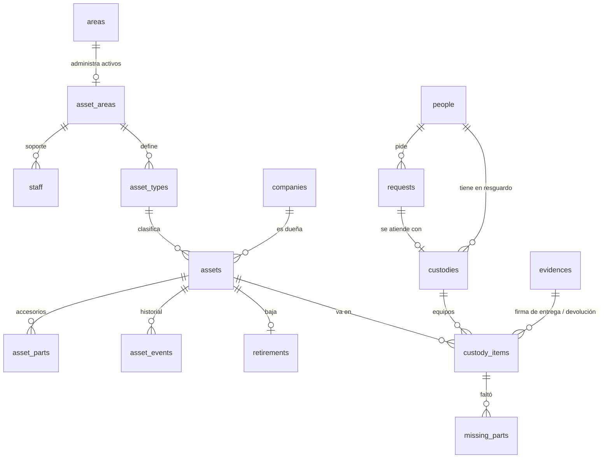

# Base de datos · Custodia

El esquema vive en `supabase/migrations/20261103100000_custodia_init.sql`, dentro del esquema de Postgres **`custodia`**, en la **misma base que Chispa y El Trueque**. El bucket privado de evidencias está en `20261103110000_custodia_storage.sql` y el ejemplo en `supabase/seed_demo.sql`. La prueba `supabase/tests/schema_check.mjs` aplica Chispa, El Trueque y Custodia juntos en PGlite y comprueba 30 reglas.

## El mapa

## Espejo del módulo de activos existente

El grupo ya tiene un módulo de activos (área que administra, tipos agrupados en hardware y licencias, catálogo de equipos, cabecera y detalle del resguardo, evidencia de entrega y de devolución). Custodia **conserva esa forma** y le agrega lo que le falta:

| Custodia | Equivale a | Lo que se agrega |
|---|---|---|
| `asset_areas` | El área que administra activos y su responsable | Liga con `public.areas` y con el personal de soporte (`staff`). |
| `asset_types` | El tipo por área, agrupado en hardware o licencia | Código, icono y orden. |
| `assets` | El catálogo: nombre, descripción, características, tipo, área, valor | Folio legible, marca, modelo, serie, etiqueta de inventario, compra, garantía, estado de ciclo de vida, condición, ubicación y la empresa dueña. |
| `custodies` | La cabecera del resguardo: persona, empresa, folio, fecha de entrega y devolución, estatus | Quién entregó, la solicitud que atendió y el texto de compromiso. |
| `custody_items` | El detalle: equipo, evidencia de entrega y de devolución | Fecha y condición de la devolución, quién recibió; devolución **parcial** con `missing_parts`. |
| `evidences` | La evidencia | Un **archivo** en Storage con tipo, tamaño y sha256, en vez del PDF en base64 dentro de la tabla. |

`rh_key` en cada tabla guarda la clave del registro existente para la migración.

## Las tablas y por qué

| Tabla | Por qué así |
|---|---|
| `asset_areas` + `staff` | Los equipos son de un **área administradora** (hoy Sistemas). Mañana mantenimiento o almacén son filas, no otra app. El rol de soporte es pertenecer a `staff` de esa área. |
| `accountants` | Quién confirma la baja del activo. |
| `asset_types` | Únicos por área (`unique (asset_area_id, code)`). El grupo decide el folio: hardware `EQ-`, licencia `LIC-`. |
| `assets` | El estado sólo cambia por funciones: el cliente puede corregir datos (marca, serie, ubicación…) pero no "asignar" a mano, porque eso tiene que dejar carta y evidencia. `unique (type_id, serial)` evita duplicados. Folio por prefijo con contador. |
| `asset_parts` | Los accesorios que viajan con el equipo (cargador, funda); permiten la devolución parcial. |
| `custodies` | Una carta por entrega, con uno o más equipos. Se cierra sola cuando vuelve el último. `check` liga estado y fecha de cierre. |
| `custody_items` | Un índice único parcial garantiza que **un equipo sólo está en una carta abierta**. Sin evidencia de entrega no hay renglón; la devolución exige la suya. |
| `missing_parts` | Lo que faltó en una devolución, en filas (no arreglo) para migrar a SQL Server. |
| `requests` | La solicitud del colaborador. Se atiende con una entrega (`delivered`) o se rechaza con nota. |
| `asset_events` | La línea de tiempo de la ficha: alta, entrega, devolución, reparación, baja, contabilidad, El Trueque, salida. |
| `retirements` | La baja en tres pasos con `check`: no hay baja sin datos borrados y cuentas retiradas; no hay destino (`trueque`, donación…) sin la baja contable. |

## Vistas

`asset_cards`: cada equipo con folio formateado, tipo y, si está asignado, quién lo tiene y en qué carta.

## Operaciones (funciones)

| Función | Quién | Qué hace |
|---|---|---|
| `handover(persona, equipos[], evidencia, solicitud)` | Soporte | Carta `RES-0000` en una transacción: equipos en almacén y de su área, evidencia, historial y solicitud entregada. |
| `receive_return(equipo, condición, evidencia, faltantes[])` | Soporte | Devolución total o parcial; con daños pasa a reparación; cierra la carta al volver todo. |
| `set_repair(equipo, sí/no, nota)` | Soporte | Manda a reparación o la regresa al almacén. |
| `retire(equipo, motivo, datos borrados, cuentas retiradas, accesorios separados)` | Soporte | Paso 1 de la baja. |
| `confirm_write_off(equipo)` | Contabilidad | Paso 2. |
| `suggested_cacaos(equipo)` | Soporte | Precio sugerido por valor de compra y antigüedad. |
| `propose_to_trueque(equipo, precio)` | Soporte | Paso 3: crea el producto pendiente en El Trueque con `trueque.create_product_from_asset`. |
| `reject_request(solicitud, nota)` | Soporte | Rechaza con motivo. |

Cuando el cupón de un equipo de Custodia se canjea en El Trueque, un trigger lo saca del inventario (`disposed`) y lo anota en su historial.

## Seguridad (RLS)

- El colaborador ve **sólo** los equipos que tiene, sus cartas, su evidencia y sus solicitudes.
- Soporte ve y opera el inventario de su área.
- Contabilidad ve el inventario y las bajas.
- Storage: sólo soporte sube a la carpeta de su área; se lee un archivo si se puede leer su fila en `evidences`.

## Paso a SQL Server (fase 2)

Igual que Chispa y El Trueque: esquema `custodia`, `uniqueidentifier`, `datetimeoffset`, índices filtrados para "una carta abierta por equipo", funciones a comandos del API y RLS a `[Authorize]`. La migración del módulo existente pasa la evidencia en base64 a archivos con su sha256 y conserva su clave en `rh_key`.

## Cómo escala

- **Más áreas que prestan:** una fila en `asset_areas`, sus tipos y su personal.
- **Historial largo:** índices por equipo y fecha; la carta y su detalle no se reescriben.
- **Préstamos temporales:** se agregan con una fecha de devolución esperada en `custodies` sin cambiar lo demás.
